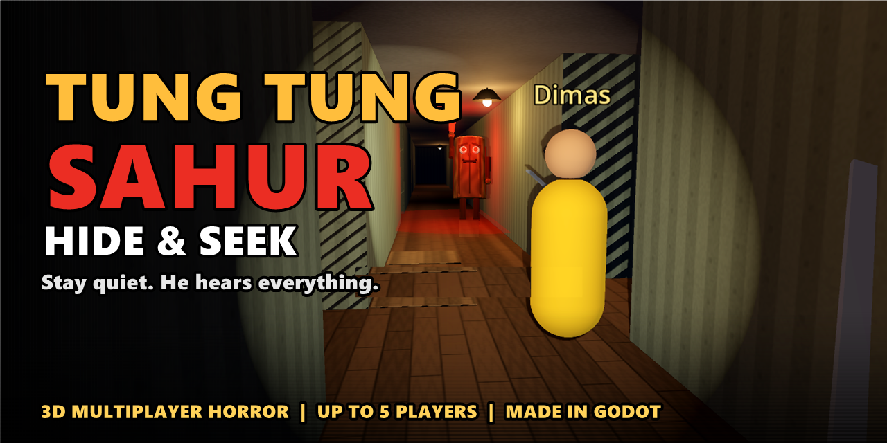
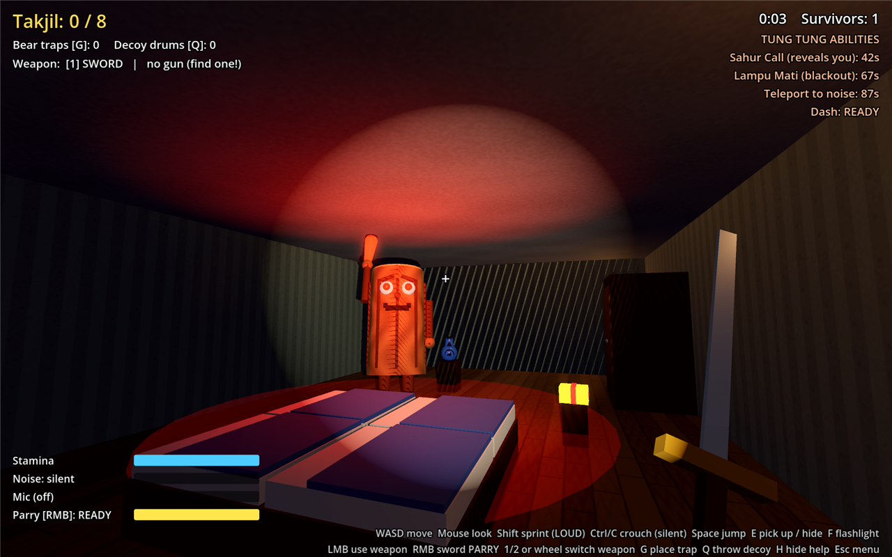
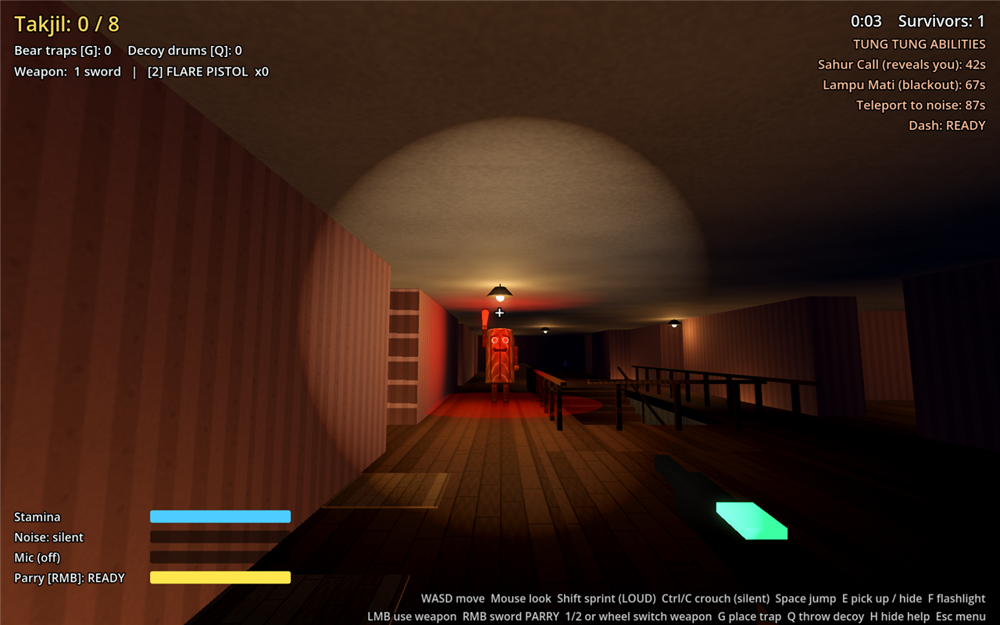

# 🥁 Tung Tung Sahur: Hide & Seek

*Tung... tung... tung...* You hear him before you see him.

A **3D first-person multiplayer horror game** made in Godot 4 at **Hack Club Jakarta**.
You and up to 4 friends are trapped in a dark house with **Tung Tung Sahur**, and he hunts by
**sound**. Find the hidden **takjil** scattered around the house, unlock the front door and escape
before he catches everyone.

## 📸 Screenshots

| He's right there... | Upstairs hallway |
|---|---|
|  |  |

## 🎤 Your voice is a weapon (against you)

The game listens through your **real microphone**. Whisper and you're safe; scream, laugh or panic
and Tung Tung knows exactly where you are. Sprinting, gunshots, knocking over vases and creaky floors
give you away too, so sneak, plan your route and stay quiet.

## 🏃 Survivor abilities

| Ability | Key | What it does |
|---|---|---|
| Sneak | Ctrl / C | Move silently and stay low |
| Sprint | Shift | Escape when he spots you (loud!) |
| Hide | E | Hide in furniture: he can't see you, but he can still **hear** you |
| Sword parry | Right mouse | Block his bat swing at the right moment to stun him |
| Flare pistol | Left mouse | Shoot his bat or head while he winds up to stun him (very loud) |
| Bear trap | G | Place a trap that stuns him when he steps on it |
| Decoy drum | Q | Throw a drum that booms and lures him away |
| Flashlight | F | See in the dark... if you dare |

## 👹 Tung Tung Sahur's abilities

| Ability | What it does |
|---|---|
| **Bat swing** | One hit and you're out |
| **Kentongan Dash** | A sudden burst of terrifying speed |
| **Sahur Call** | "TUNG TUNG TUNG SAHUR!" senses where a survivor is |
| **Lampu Mati** | Cuts the lights across the house |
| **Teleport** | Appears at the last noise he heard |
| **Rage** | The closer you are to winning, the faster and angrier he gets |

His abilities unlock as the hunt goes on. Get caught and you become a ghost who can fly through
walls and watch the others.

## 👥 Multiplayer

- Up to **5 survivors** on the same Wi-Fi (LAN, port 7777)
- Tung Tung is controlled by **AI**, or by the **host** for the ultimate betrayal
- One player clicks **Host Game** and shares the IP shown; everyone else types it and clicks **Join**

> If friends can't connect on venue Wi-Fi, have everyone join one phone's hotspot instead.
> Windows will ask to allow Godot through the firewall the first time you host: click **Allow**.

## ▶️ How to run

1. Install [Godot 4.7](https://godotengine.org/download)
2. Clone or download this repo
3. In Godot click **Import** and choose `project.godot`
4. Press **F5** to play

## 🎮 Controls

**Survivors:** WASD move · Mouse look · Shift sprint · Ctrl crouch · Space jump · E pick up / hide ·
F flashlight · LMB use weapon · RMB parry · 1/2 or wheel switch weapon · G trap · Q decoy · Esc menu

**Tung Tung (host):** WASD move · Mouse look · LMB bat swing · Q dash · E Sahur Call · R teleport ·
X Lampu Mati · Esc menu

## 🛠️ Built with

- [Godot 4.7](https://godotengine.org/) (GDScript)
- All sounds are generated in code; no audio files
- Made with help from Claude (AI)

*Made at Hack Club Jakarta.*
